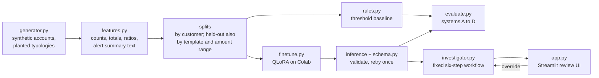

# Architecture

The model labels and explains; Python counts. Features are computed in Python, the model reads a summary of them and returns a typology, a risk level and a reason, and every output is validated before an analyst sees it.

## Pipeline

Training runs on Colab; everything else runs on the laptop.

## Modules

| File | Responsibility |
| --- | --- |
| `src/models.py` | Plain data containers: `Transaction`, `Customer`, `RawAlert` |
| `src/names.py` | Two pools of made-up names: one for train, validation and test, one only for the held-out set |
| `src/patterns.py` | Builds a 30-day history: everyday income and spending, then one planted typology or look-alike |
| `src/generator.py` | Split plans, customers, deterministic generation (seed 42) and saving raw alerts to `data/raw/` (not committed) |
| `src/money.py` | Rupee formatting with Indian digit grouping, and plurals |
| `src/features.py` | Computes every number about an alert (cash, large credits, sender bursts, returned money, payees, totals), the risk level and the one-line reason |
| `src/templates.py` | Five wording templates (three shared, two reserved for held-out) that render the same facts as summary text |
| `src/dataset.py` | Builds one training example per alert (summary, label, features) and writes `data/train.jsonl`, `validation.jsonl`, `test.jsonl`, `heldout.jsonl` |
| `src/rules.py` | Configurable threshold rules with rule ids and reasons (system A) |
| `src/metrics.py` | Precision, recall, F1, macro-F1 and false-positive rates by kind of alert |
| `src/schema.py` | Label lists, JSON schema, output validation, banned wording, faithfulness check |
| `src/prompt.py` | The system prompt and answer format, shared by training and inference |
| `src/finetune.py` | QLoRA training script (runs on Colab); loss on the answer only; saves adapter and checkpoints |
| `src/predict.py` | Loads the base model plus adapter; classifies an alert; validates with `schema.py`; retries once; saves answers to `results/` |
| `src/evaluate.py` | Scores systems on validation and test; held-out only with `--final` |
| `src/investigator.py` | The six-step workflow, case memory, audit log |
| `app.py` | Streamlit UI: Alerts, Alert detail, Evaluation, Audit log |
| `notebooks/finetune_qlora.ipynb` | Thin Colab wrapper that clones the repo and calls `src/finetune.py` |

## Data model

`RawAlert` (generator output): `alert_id`, `split`, `template_group` (shared or heldout), `customer`, `window_start`, `window_end`, `transactions`, `typology`, `hard_negative_kind`. Each customer appears in exactly one alert.

`Alert` (training example, built from a `RawAlert` in the features step): `alert_id`, `customer_id`, `profile` (occupation, declared monthly income, account age in months), `window_days`, `features` (dict of computed values), `summary` (rendered text), `template_id`, `split`, `hard_negative`, `label` (typology, risk, reason).

`Customer`: `customer_id`, `occupation`, `declared_monthly_income`, `account_age_months`.

`Transaction`: `txn_id`, `day`, `amount` (whole rupees, positive), `direction`, `channel`, `counterparty`.

`Verdict`: `alert_id`, `typology`, `risk`, `reason`, `source` (rules, base, fine-tuned or analyst), `valid`, `created_at`.

`AuditEvent`: `time`, `alert_id`, `action`, `before`, `after`, `note`. The original alert is never changed; analyst decisions are overlays.

## Key design points

**Features before text.** Python computes every number (for example "9 cash deposits just under the ₹50,000 limit within 5 days") and renders them into the alert summary. The model never invents a number, and the faithfulness check enforces it.

**What the numbers measure** (thresholds are named constants at the top of `features.py`):
- Cash: deposits, and how many sit between 80% and 99% of the ₹50,000 reporting limit.
- Large credits (₹50,000 or more): how much of each left for other people within 2 days. Money moved to the customer's own deposit does not count as sent on.
- Sender burst: the busiest 7-day span with the most different senders by UPI or IMPS, and how much left within 5 days of its last payment. Looking at one burst keeps regular income, such as weekly payouts, from hiding it.
- Returned money: transfers of ₹10,000 or more that came back within 15 days at 90% to 105% of the amount. Only transfers pair up; cash and salary never do.
- Overall: biggest payees, totals, and totals compared with declared monthly income.

**Risk.** For a pattern, risk is the amount at issue divided by declared monthly income: below 5 is low, 5 to under 15 is medium, 15 or more is high. Normal activity is always low. The ratio is printed in the summary, so the label follows from numbers the model can see. The cut-offs were chosen on the training set only.

**No shortcuts in the text.** Summaries never state the number of transactions, which would separate ordinary alerts from patterns by length alone. Every summary is under about 190 tokens.

**Several wording templates.** Each alert can be rendered by several templates. Some templates are reserved for the held-out set, so the model has to learn the pattern, not the phrasing.

**Splits.** Customers are assigned to a split before any alert is generated, and every customer belongs to exactly one of train, validation, test and held-out. Train, validation and test share wording templates. The held-out set uses templates reserved for it and different amount ranges, so it measures whether the model learned the pattern and not the phrasing.

**Prompt format.** A short system prompt asks for JSON only; the user turn is the alert summary; the assistant turn is `{"typology": ..., "risk": ..., "reason": ...}`. Loss is computed on the assistant turn only.

**Training starting values** (tuned on the validation set only): base model Qwen2.5-1.5B-Instruct, 4-bit NF4 quantisation, LoRA rank 16, alpha 32, dropout 0.05, all linear layers, learning rate 2e-4, 2 to 3 epochs, maximum sequence length 512, checkpoint every few steps to Google Drive.

**Inference and validation.** The output must parse as JSON, use a typology and risk from the fixed lists, have a reason of at most 200 characters, and cite only numbers that appear in the input. An invalid answer is retried once; if it fails again the alert goes to "needs review" with no verdict.

**Investigation workflow** (fixed, no free-form planning):
1. Load the alert.
2. Fetch the account's transactions for the window.
3. Compute velocity and profile comparison.
4. Classify with the fine-tuned model.
5. Draft a case note from the verdict and the evidence.
6. Analyst approves or overrides.

Case memory is a JSON case file that later steps append to. Guardrails: banned wording is rejected, and nothing with side effects runs before step 6.

**Why a fixed workflow.** Small models call tools unreliably. A fixed sequence with the model used only as the classifier is predictable and testable. An LLM planner is a later upgrade.

## Evaluation

| System | Description |
| --- | --- |
| A | Threshold rules |
| B | Base model, prompted only |
| C | Fine-tuned model |
| D (optional) | Prompted Claude |

Metrics: per-typology precision, recall and F1; macro-F1; false-positive rate on benign and hard negatives; JSON validity rate; faithfulness rate. Reported on test and held-out. The held-out set is run once at the end. Rules are never adjusted after seeing held-out errors.

## Extension points

| Change | Where |
| --- | --- |
| New typology | Generator pattern, feature, label list in `schema.py`, rule, and retrain |
| New wording template | `features.py` template list; mark it train, validation, test or held-out |
| Larger base model | `finetune.py` model argument; keep the same prompt format |
| LLM planner | Replace the fixed sequence in `investigator.py`, keeping the same guardrails |
| Persistent audit log | Replace session state in `app.py` with a store keyed by case id |

## Known limits

- All data is synthetic, so scores say nothing about real-world accuracy.
- Thresholds are illustrative, not regulatory.
- Corrections live in session state and are lost when the session ends.
- CPU inference of the fine-tuned model is slow; the demo can use precomputed verdicts.
