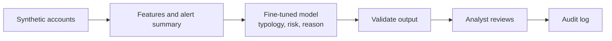

# AML Alert Investigator

A small open language model, fine-tuned with QLoRA, that reads an anti-money-laundering alert and returns a typology, a risk level and a one-line reason. A fixed investigation workflow wraps it, and an analyst approves or overrides every verdict.

**Status: in progress.** The five docs, the synthetic data generator, the features, the alert summaries, the dataset files and the rules baseline with scoring are done (77 tests). The model has been fine-tuned and scored on validation and test (table below). The held-out run, the investigator workflow, the app and the Hugging Face release come next.

All data is synthetic. No real customer or transaction data is used anywhere. This is a prototype, not certified for any regulator's requirements.

Docs: [PRD](PRD.md) · [Architecture](ARCHITECTURE.md) · [Design system](DESIGN_SYSTEM.md) · [Agent instructions](AGENTS.md)

## What it will do

1. **Generate** synthetic accounts with planted patterns: structuring, rapid pass-through, mule accounts, round-tripping, plus benign cases and hard negatives (legitimate activity that looks suspicious).
2. **Compute** every count, amount and ratio in Python, and render an alert summary from them.
3. **Fine-tune** Qwen2.5-1.5B-Instruct with QLoRA on Google Colab to return JSON: `typology`, `risk`, `reason`.
4. **Compare** the fine-tuned model with threshold rules and the un-tuned base model on data it never saw.
5. **Investigate** through six fixed steps, ending with the analyst's decision and an audit log.

The model labels and explains; Python counts. The model never produces a number that is not already in its input, and a check enforces it.



## Results

Scored on the validation and test sets, which share wording templates with the training data. The held-out set (new wording, larger incomes) has not been scored yet; it is run once at the end.

| System | Macro-F1 (test) | Macro-F1 (held-out) | False alarms on normal alerts (test) | Valid JSON (test) | Risk accuracy (test) |
| --- | --- | --- | --- | --- | --- |
| A1. Rules, default thresholds | 0.962 | not run | 8.1% | n/a | n/a |
| A2. Rules, tuned on train | 0.990 | not run | 0.0% | n/a | n/a |
| B. Base model, prompted only | 0.135 | not run | 100% | 88.5% | 23.8% |
| C. Fine-tuned model | 1.000 | not run | 0.0% | 100% | 99.8% |
| D. Prompted Claude (optional) | not run | not run | not run | not run | not run |

How to read this:
- The fine-tuned model ties the tuned rules on typology (a gap of about two alerts out of 400). The rules read exact computed numbers; the model reads only text, and also returns a risk level and a reason that passes the faithfulness check, which the rules cannot do.
- The default rules flag 80% of the "salary then commitments" look-alikes. The fine-tuned model flags none.
- The base model was told the label names but not what they mean, and was given no examples, so it shows what training added, not what the best possible prompt could do.
- The task is easy by design: the summary prints the numbers that decide the label. A near-perfect score on test is expected, and the held-out set is the real check.

## Quick start

Works today:

```bash
python3 -m venv .venv && source .venv/bin/activate
pip install -r requirements.txt
python -m src.generator       # writes 3,400 synthetic alerts to data/raw/ (about a second)
python -m src.dataset         # writes data/train.jsonl, validation.jsonl, test.jsonl, heldout.jsonl
python -m pytest -q           # 77 tests
python -m src.evaluate        # scores the rules baseline on validation and test
```

Planned, once the code is added:

```bash
streamlit run app.py          # opens the review UI
```

Training runs on Colab (a free T4 GPU is enough for the 1.5B model); heavy libraries are kept out of the laptop requirements.

## Planned layout

```
aml-alert-investigator/
├─ PRD.md  ARCHITECTURE.md  AGENTS.md  DESIGN_SYSTEM.md  README.md
├─ src/        models.py  names.py  patterns.py  generator.py  schema.py   (done)
│              money.py  features.py  templates.py  dataset.py           (done)
│              metrics.py  rules.py  evaluate.py  prompt.py  finetune.py (written)
│              predict.py (written)  investigator.py                    (planned)
├─ notebooks/  finetune_qlora.ipynb      (thin Colab wrapper)
├─ data/       train, validation, test and held-out sets
├─ tests/
└─ app.py
```

## Design choices

- **Honest evaluation.** Customers are split before any data is generated, and each belongs to exactly one set. The held-out set also uses reserved wording templates and amount ranges, and is run once at the end.
- **Hard negatives.** Legitimate look-alikes are in the training and test data, so the false-positive rate is measured, not hoped for.
- **Fixed workflow, not a free-roaming agent.** Small models call tools unreliably, so the model is used as the classifier inside a predictable sequence. An LLM planner is a later upgrade.
- **Review, never accuse.** The system says "refer for review". Nothing is filed or sent without the analyst.
- **Readable code.** Plain names, short functions, docstrings and named constants, so every file can be read and explained.

## Security and privacy

- Synthetic data only; no real customer data and no credentials in the repository.
- Training happens on Colab with synthetic data. Secrets (such as a GitHub or Hugging Face token) are kept in Colab Secrets, never in notebooks.
- No customer data is sent to any external service at inference time unless the optional prompted-Claude baseline is run, which uses synthetic alerts only.

## AI tools used and key workflows

Built with Claude (Anthropic) as a coding assistant. The classifier is a fine-tuned open-weights model (Qwen2.5-1.5B-Instruct as the starting point; check the base model's licence before publishing merged weights). The key workflow is: generate data, compute features, validate outputs, then evaluate against the baselines. ARCHITECTURE.md describes each step.

## Limitations

- Scores are on synthetic data and say nothing about real-world accuracy.
- Thresholds are illustrative, not regulatory.
- The analyst's decisions live in session state and are lost when the session ends.
- Running the fine-tuned model on a CPU is slow, so the demo may use precomputed verdicts for the sample alerts.

## Roadmap

Week 0 practice fine-tune · Week 1 data and rules baseline · Week 2 first fine-tune · Week 3 evaluation · Week 4 workflow and app · Week 5 publish.
