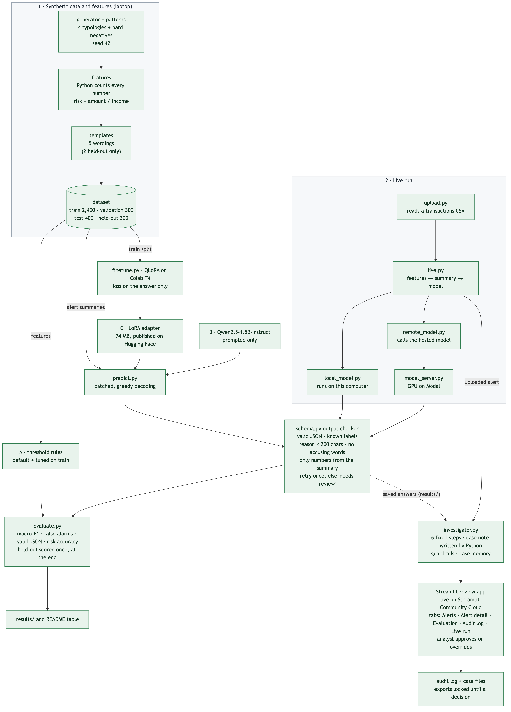

# AML Alert Investigator

A small open language model, fine-tuned with QLoRA, that reads an anti-money-laundering alert and returns a typology, a risk level and a one-line reason. A fixed investigation workflow wraps it, and an analyst approves or overrides every verdict.

**Status: in progress.** The five docs, the synthetic data generator, the features, the alert summaries, the dataset files and the rules baseline with scoring are done (116 tests). The model has been fine-tuned and scored on validation, test and held-out (table below). The adapter and dataset are published on Hugging Face. The six-step investigator workflow (case files, audit log, guarded exports) and the review app are built and live as a demo (link below), running on saved model answers. A "Live run" tab takes an uploaded transactions CSV and asks the hosted model (133 tests); it needs the model server deployed, see "Live run" below.

All data is synthetic. No real customer or transaction data is used anywhere. This is a prototype, not certified for any regulator's requirements.

**Live demo:** [https://aml-alert-investigator.streamlit.app](https://aml-alert-investigator.streamlit.app) (saved model answers, no GPU; a shared demo on synthetic data; it sleeps when idle, so the first visit takes about 30 seconds)

Published: [fine-tuned adapter](https://huggingface.co/coachuttam/aml-alert-investigator-qwen2.5-1.5b-qlora) · [synthetic dataset](https://huggingface.co/datasets/coachuttam/aml-alert-investigator-data) (both on Hugging Face)

Docs: [PRD](PRD.md) · [Architecture](ARCHITECTURE.md) · [Design system](DESIGN_SYSTEM.md) · [Agent instructions](AGENTS.md)

## What it will do

1. **Generate** synthetic accounts with planted patterns: structuring, rapid pass-through, mule accounts, round-tripping, plus benign cases and hard negatives (legitimate activity that looks suspicious).
2. **Compute** every count, amount and ratio in Python, and render an alert summary from them.
3. **Fine-tune** Qwen2.5-1.5B-Instruct with QLoRA on Google Colab to return JSON: `typology`, `risk`, `reason`.
4. **Compare** the fine-tuned model with threshold rules and the un-tuned base model on data it never saw.
5. **Investigate** through six fixed steps, ending with the analyst's decision and an audit log.

The model labels and explains; Python counts. The model never produces a number that is not already in its input, and a check enforces it.



Green boxes are built. Details are in [ARCHITECTURE.md](ARCHITECTURE.md).

## Results

Test shares its wording templates with the training data. Held-out uses new wording templates and incomes 1.6 times larger, and was scored once, after all training and rule choices were fixed. Nothing was tuned on it.

| System | Macro-F1 (test) | Macro-F1 (held-out) | False alarms on normal alerts (test / held-out) | Valid JSON (test / held-out) | Risk accuracy (test / held-out) |
| --- | --- | --- | --- | --- | --- |
| A1. Rules, default thresholds | 0.962 | 0.948 | 8.1% / 14.2% | n/a | n/a |
| A2. Rules, tuned on train | 0.990 | 0.990 | 0.0% / 1.7% | n/a | n/a |
| B. Base model, prompted only | 0.135 | 0.181 | 100% / 100% | 88.5% / 72.0% | 23.8% / 23.3% |
| C. Fine-tuned model | 1.000 | 0.936 | 0.0% / 8.3% | 100% / 99.7% | 99.8% / 99.7% |
| D. Prompted Claude (optional) | not run | not run | not run | not run | not run |

What the results say:
- **Fine-tuning works.** The base model scores 0.135 on test (0.181 on held-out, with only 72% valid JSON) and never answers "no concern". The fine-tuned model scores 1.000 on test, with valid JSON, faithful reasons and the right risk level in almost every case.
- **It did not beat the tuned rules on held-out.** The fine-tuned model scored 0.936 against 0.990 for the tuned rules, and was slightly below the default rules (0.948). The target in the PRD was for it to win; it did not.
- **Where it slipped on held-out:** mule accounts (F1 0.83) and the "salary then commitments" look-alike, which it flagged 53% of the time (0% on test). Tuned rules read exact computed numbers, so new wording does not affect them. The model reads text, and the held-out wording and amounts were new to it.
- **What held up:** valid JSON, faithful reasons and risk accuracy all stayed near 99.7%, and structuring stayed perfect.
- **The task is easy by design.** The summary prints the numbers that decide the label, so a near-perfect test score is expected. Held-out is the real check, and it shows a generalisation gap.
- The base model was told only the label names, with no definitions or examples, so it shows what training added, not what the best prompt could do.

Next experiment (a clearly labelled v2, not a tweak of these numbers): add more wording styles and income scales to the training data, retrain, and score on a new held-out set.

## Quick start

Works today:

```bash
python3 -m venv .venv && source .venv/bin/activate
pip install -r requirements.txt
python -m src.generator       # writes 3,400 synthetic alerts to data/raw/ (about a second)
python -m src.dataset         # writes data/train.jsonl, validation.jsonl, test.jsonl, heldout.jsonl
python -m pytest -q           # 133 tests
python -m src.evaluate        # scores the rules baseline on validation and test
streamlit run app.py          # opens the review app (uses the saved answers in results/)
```

Training runs on Colab (a free T4 GPU is enough for the 1.5B model); heavy libraries are kept out of the laptop requirements.

## Live run

The "Live run" tab reads a transactions CSV (`day,amount,direction,channel,counterparty`; a sample is in `data/sample_upload.csv`), computes the features in Python, asks the fine-tuned model and shows the checked answer like any saved alert. The app has no GPU, so the model runs on [Modal](https://modal.com) and sleeps when idle:

```bash
pip install modal && modal setup
modal deploy model_server.py      # prints the endpoint address
```

Then create a proxy auth token in the Modal dashboard and give the app three settings (environment variables locally, Secrets on Streamlit Community Cloud): `AML_MODEL_URL`, `AML_MODEL_KEY`, `AML_MODEL_SECRET`. Without them, or if the model does not answer, an upload goes to "needs review" and the rules and computed findings still run. The first call after a sleep takes about a minute. `model_server.py` has not been run in CI; check it after deploying.

To run the model on your own computer instead (no cloud, nothing leaves the machine):

```bash
pip install -r requirements-local.txt
AML_LOCAL_MODEL=1 streamlit run app.py
```

The first live run downloads the base model (about 3 GB) and takes a few minutes; later runs answer in seconds. On a Mac the base model is loaded at half precision, not the 4-bit copy used for the published scores, so answers should match closely but this setup was not the one scored.

## Layout

```
aml-alert-investigator/
├─ PRD.md  ARCHITECTURE.md  AGENTS.md  DESIGN_SYSTEM.md  README.md
├─ src/        models.py  names.py  patterns.py  generator.py  schema.py   (done)
│              money.py  features.py  templates.py  dataset.py           (done)
│              metrics.py  rules.py  evaluate.py  prompt.py  finetune.py (written)
│              predict.py review.py review_scores.py (done)
│              investigator.py case_note.py case_store.py audit.py (done)
│              upload.py  live.py  remote_model.py  local_model.py       (live run)
├─ notebooks/  finetune_qlora.ipynb      (thin Colab wrapper)
├─ data/       train, validation, test and held-out sets
├─ tests/
├─ app.py  upload_view.py                (review app and its "Live run" tab)
└─ model_server.py                       (hosts the model on Modal)
```

## Design choices

- **Honest evaluation.** Customers are split before any data is generated, and each belongs to exactly one set. The held-out set also uses reserved wording templates and amount ranges, and is run once at the end.
- **Hard negatives.** Legitimate look-alikes are in the training and test data, so the false-positive rate is measured, not hoped for.
- **Fixed workflow, not a free-roaming agent.** Small models call tools unreliably, so the model is used as the classifier inside a predictable sequence. An LLM planner is a later upgrade.
- **Review, never accuse.** The system says "refer for review". Nothing is filed or sent without the analyst.
- **Readable code.** Plain names, short functions, docstrings and named constants, so every file can be read and explained.

## Security and privacy

- Synthetic data only; no real customer data and no credentials in the repository.
- Training happens on Colab with synthetic data. Secrets (such as a GitHub or Hugging Face token) are kept in Colab Secrets, never in notebooks.
- No customer data is sent to any external service at inference time unless the optional prompted-Claude baseline is run, which uses synthetic alerts only.

## AI tools used and key workflows

Built with Claude (Anthropic) as a coding assistant. The classifier is a fine-tuned open-weights model (Qwen2.5-1.5B-Instruct as the starting point; check the base model's licence before publishing merged weights). The key workflow is: generate data, compute features, validate outputs, then evaluate against the baselines. ARCHITECTURE.md describes each step.

## Limitations

- Scores are on synthetic data and say nothing about real-world accuracy.
- Thresholds are illustrative, not regulatory.
- The analyst's decisions live in session state and are lost when the session ends.
- The sample alerts use saved verdicts. Live uploads need the hosted model, which takes about a minute to wake.
- An uploaded file must already use the eight channel names the generator uses; real bank exports would need a mapping step.

## Roadmap

Week 0 practice fine-tune · Week 1 data and rules baseline · Week 2 first fine-tune · Week 3 evaluation · Week 4 workflow and app · Week 5 publish.

## Licence

Code: MIT (see LICENSE). The published adapter and dataset are Apache-2.0. The base model, Qwen2.5-1.5B-Instruct, is Apache-2.0 under its own terms.
